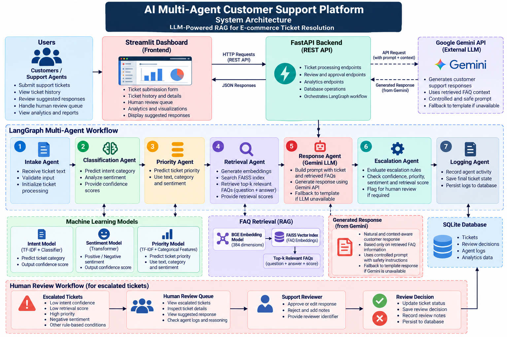

# AI Multi-Agent Customer Support Platform

An AI-powered e-commerce customer support platform that combines **machine learning, Retrieval-Augmented Generation (RAG), Google Gemini, and LangGraph** to classify support tickets, retrieve relevant FAQs, generate suggested responses, and route uncertain cases for human review.

**Technologies:** Python · scikit-learn · Transformers · FAISS · LangGraph · Gemini API · FastAPI · Streamlit · SQLite

## Architecture

The architecture below illustrates the complete ticket-processing workflow, including machine learning, FAQ retrieval, Gemini response generation, fallback handling, persistence, and human review.



## Project Overview

E-commerce support teams handle queries about delivery delays, payments, refunds, account access, and product issues. Manual classification and response preparation can increase resolution times and operational workload.

This project implements a multi-agent workflow that processes customer tickets, retrieves relevant knowledge from an FAQ database, and uses the Google Gemini API to generate context-aware customer-support responses.

A configurable escalation mechanism routes tickets that meet specified rules to a human-review queue. Ticket details, responses, review decisions, and agent execution logs are stored in SQLite.

## Key Features

- **Ticket Intake:** Validates incoming customer messages and initializes ticket processing.
- **Intent Classification:** Predicts the customer-support ticket category using a trained ML model.
- **Sentiment Analysis:** Uses a pretrained transformer model to classify sentiment as positive or negative.
- **Priority Prediction:** Predicts ticket priority using ticket text, predicted category, and sentiment features.
- **Semantic FAQ Retrieval:** Uses BGE embeddings and FAISS similarity search to retrieve relevant FAQ content.
- **Gemini-Powered Response Generation:** Uses the Google Gemini API to generate customer-facing responses grounded in retrieved FAQ context.
- **Fallback Handling:** Uses a template-based FAQ response when Gemini is unavailable and a safe acknowledgement when no FAQ is retrieved.
- **Escalation Management:** Applies configurable rules based on intent confidence, priority, sentiment, and retrieval score.
- **Human-in-the-Loop Review:** Allows reviewers to approve or reject suggested responses and record review notes.
- **Agent Execution Logs:** Records agent activity and relevant processing details.
- **Persistent Storage:** Stores tickets, review decisions, and agent logs in SQLite.
- **REST API:** Exposes ticket processing, history, logs, human review, and analytics through FastAPI.
- **Interactive Dashboard:** Provides ticket submission, ticket history, human-review queue, and analytics through Streamlit.

## Technology Stack

| Component | Technology |
|---|---|
| Programming language | Python |
| Data processing | Pandas, NumPy |
| Machine learning | scikit-learn |
| NLP and sentiment analysis | Transformers, PyTorch |
| Text embeddings | `BAAI/bge-small-en-v1.5` |
| Vector database/search | FAISS |
| LLM response generation | Google Gemini API |
| Gemini Python SDK | `google-genai` |
| Environment configuration | `python-dotenv` |
| Agent orchestration | LangGraph |
| Backend API | FastAPI, Uvicorn |
| Dashboard | Streamlit |
| Database | SQLite |
| Model persistence | Pickle/joblib-based artifacts |

## System Workflow

The LangGraph workflow consists of seven agents.

1. **Intake Agent:** Validates the ticket and initializes its processing state.
2. **Classification Agent:** Predicts ticket intent and analyzes sentiment.
3. **Priority Agent:** Predicts ticket priority using the available features.
4. **Retrieval Agent:** Embeds the customer query and searches the FAISS FAQ index.
5. **Response Agent:** Sends the customer query and retrieved FAQ context to Gemini to generate a suggested response.
6. **Escalation Agent:** Evaluates configured escalation rules and determines whether human review is required.
7. **Logging Agent:** Records processing activity and final ticket state.

The completed workflow saves ticket data and agent logs to SQLite. Tickets requiring review are available through the human-review queue.

### Gemini-Powered RAG

The response-generation process follows this sequence:

1. Receive the customer ticket.
2. Retrieve relevant FAQ questions and answers using BGE embeddings and FAISS.
3. Construct a prompt containing the customer query, retrieved context, and response-generation instructions.
4. Send the prompt to the configured Gemini model.
5. Return a suggested response grounded in the retrieved FAQ content.
6. Use a fallback response if generation fails or no FAQ context is available.

The prompt instructs Gemini not to invent policies, promise refunds, claim transactions were completed, or assert account changes without supporting information.

**Important:** Prompt instructions reduce unsupported claims but do not guarantee that every generated statement is correct. Human review remains important for uncertain or high-risk cases.

## Dataset

The development project uses two primary datasets.

### Support Tickets

- Original records: 10,000
- Unique ticket texts after deduplication: 8,777
- Includes ticket text, category, priority, sentiment, resolution details, escalation status, and customer satisfaction.

### FAQ Knowledge Base

- FAQ records: 150
- Includes FAQ ID, question, answer, and category.
- Serves as the knowledge source for retrieval and response generation.

### Supported Ticket Categories

- Account & Login
- App & Website Issue
- Delivery Issue
- Payment Issue
- Product Issue
- Refund & Return
- Seller & Product Listing

Only publish datasets you have permission to share. Do not commit confidential, personally identifiable, or otherwise sensitive customer information.

## Model and Retrieval Evaluation

The following are previously recorded development results. They are not guarantees of performance on unseen or production data.

| Component | Metric | Result |
|---|---|---:|
| Intent classification | Accuracy | 99.94% |
| Priority prediction | Weighted F1 score | 93.60% |
| FAQ retrieval | Recall@1 | 70.91% |
| FAQ retrieval | Recall@3 | 91.79% |
| FAQ retrieval | Recall@5 | 95.93% |

The FAQ retrieval system uses normalized 384-dimensional BGE embeddings and FAISS inner-product similarity search.

### Evaluation Limitations

- Intent-classification performance should be verified on a genuinely unseen, representative dataset.
- The priority model relies on predicted category and binary sentiment features, so upstream prediction errors can affect its results.
- The sentiment model is pretrained for binary positive/negative classification; it is not a dedicated five-class sentiment model.
- Retrieval metrics depend on the evaluation queries and relevance labels.
- Gemini response quality has not been assigned a formal benchmark score in the reported results.
- The configured confidence and retrieval thresholds are rule-based safeguards and require further calibration.

## Project Structure

The following is a representative structure. Adjust it to match the actual files in your repository.

```text
Multi-Agent Customer Support Platform/
├── agents/
│   ├── intake_agent.py
│   ├── classification_agent.py
│   ├── priority_agent.py
│   ├── retrieval_agent.py
│   ├── response_agent.py
│   ├── escalation_agent.py
│   └── logging_agent.py
├── app/
│   ├── main.py
│   └── dashboard.py
├── data/
│   ├── raw/
│   ├── processed/
│   ├── vector_store/
│   └── database/
├── database/
│   ├── db.py
│   └── queries.py
├── graph/
│   ├── state.py
│   ├── nodes.py
│   └── workflow.py
├── llm/
│   └── gemini_client.py
├── models/
│   ├── intent/
│   ├── priority/
│   └── sentiment/
├── notebooks/
├── rag/
│   ├── embeddings.py
│   ├── build_faiss_index.py
│   └── retriever.py
├── tests/
├── docs/
│   └── architecture.png
├── .env.example
├── .gitignore
├── requirements.txt
└── README.md
```

## Installation and Setup

### Prerequisites

- Python compatible with the project's installed dependencies
- Git
- Visual Studio Code or another Python IDE
- A Google AI Studio API key
- Internet access for dependency installation and API calls

### 1. Clone the Repository

Replace the placeholders with your actual GitHub username and repository name.

```bash
git clone https://github.com/YOUR-USERNAME/YOUR-REPOSITORY.git
cd YOUR-REPOSITORY
```

### 2. Create a Virtual Environment

On Windows PowerShell:

```powershell
python -m venv venv
.\venv\Scripts\Activate.ps1
```

### 3. Install Dependencies

```powershell
python -m pip install --upgrade pip
python -m pip install -r requirements.txt
```

### 4. Configure the Gemini API

Create a local `.env` file in the project root:

```dotenv
GEMINI_API_KEY=your_google_ai_studio_api_key
GEMINI_MODEL=your_available_gemini_model
```

Obtain an API key from [Google AI Studio](https://aistudio.google.com/apikey).

Set `GEMINI_MODEL` to a model identifier that is available to your account and supports text generation.

**Security:** Never commit `.env` or expose your API key in source code, screenshots, logs, or public repositories. Keep `.env.example` limited to placeholder values.

### 5. Prepare Models and Data

Verify that the required resources are available in their expected locations:

- Intent-model and vectorizer artifacts
- Priority-model and preprocessing artifacts
- FAQ CSV file
- FAISS index and FAQ metadata
- Required database initialization code

If model files or the vector index are excluded from GitHub, regenerate or obtain them using the project's setup procedures.

Initialize the SQLite database through the project's existing database initialization function before processing tickets.

## Running the Application

Run the commands from the project root with the virtual environment activated.

### Start FastAPI

```powershell
python -m uvicorn app.main:app --reload
```

API base URL: `http://127.0.0.1:8000`

Interactive API documentation: `http://127.0.0.1:8000/docs`

Health check: `http://127.0.0.1:8000/health`

### Start Streamlit

Open a second VS Code terminal, activate the virtual environment, and run:

```powershell
python -m streamlit run app/dashboard.py
```

Dashboard URL: `http://localhost:8501`

## API Endpoints

| Method | Endpoint | Description |
|---|---|---|
| GET | `/health` | Check API health |
| POST | `/tickets` | Process a new support ticket |
| GET | `/tickets` | Retrieve ticket history |
| GET | `/tickets/{ticket_id}` | Retrieve ticket details |
| GET | `/tickets/{ticket_id}/logs` | Retrieve agent execution logs |
| GET | `/analytics` | Retrieve ticket and review statistics |
| GET | `/human-review-queue` | List tickets awaiting human review |
| POST | `/tickets/{ticket_id}/review` | Approve or reject a suggested response |

## Human-in-the-Loop Review

Tickets meeting the configured escalation rules can enter the `pending_human_review` state.

Reviewers can inspect the ticket details, predicted intent, confidence, priority, sentiment, retrieval score, suggested response, and escalation reason.

A reviewer can approve or reject a suggestion, record notes, and provide a reviewer identifier. Review decisions are stored in SQLite alongside the relevant ticket and audit information.

Approval records the review decision; it does not automatically send the response to the customer.

Human review is implemented as a persisted queue and post-processing decision workflow. It does not currently pause and resume LangGraph execution itself.

## Testing

Run the project's tests from the repository root. For tests organized as importable modules:

```powershell
python -m unittest discover -s tests
```

Some tests may be standalone scripts and should be run using their documented paths.

Test the Gemini client, response-generation fallback, complete LangGraph workflow, database persistence, and human-review workflow before deploying changes.

## Limitations and Future Improvements

- Add authentication and role-based access control for support reviewers.
- Improve model confidence calibration and class-specific evaluation.
- Evaluate models using representative unseen test data.
- Add automated checks for response grounding and quality.
- Improve Gemini quota handling, retries, and API error monitoring.
- Add automated testing and continuous integration.
- Integrate with a production customer-support platform where appropriate.
- Document a reproducible procedure for rebuilding excluded model artifacts and the FAISS index.

## Disclaimer

This project is intended for educational, demonstration, and further-development purposes. Model predictions and generated response suggestions should be evaluated before use in real customer-support operations. The system does not independently execute refunds, payments, account changes, or other customer transactions.

## Author
Rucha Kudale

**AI Multi-Agent Customer Support Platform**

Developed using Python, machine learning, NLP, RAG, Google Gemini, LangGraph, FastAPI, Streamlit, and SQLite.
